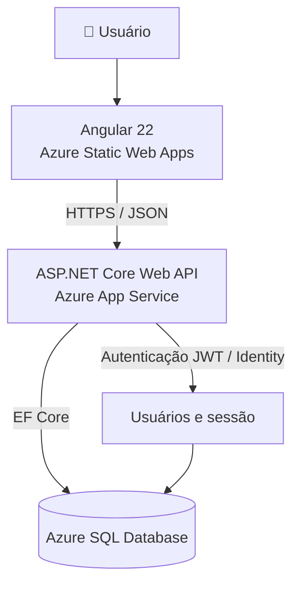

<div align="center">

# 📝 NoteKeeper

### Suas ideias organizadas. Suas notas, do seu jeito.

**Aplicação full stack para gerenciar notas e categorias com autenticação, filtros e armazenamento na nuvem.**

[](https://angular.dev/)
[](https://dotnet.microsoft.com/)
[](https://azure.microsoft.com/products/azure-sql/database)
[](https://www.typescriptlang.org/)

[**🚀 Acessar aplicação**](https://red-ocean-0e030690f.4.azurestaticapps.net/) · [**📂 Código-fonte**](https://github.com/GustavoTessaro/NoteKeeper) · [**⚙️ GitHub Actions**](https://github.com/GustavoTessaro/NoteKeeper/actions)

</div>

---

## ✨ Sobre o projeto

O **NoteKeeper** é uma aplicação web para organizar anotações pessoais de maneira simples, rápida e segura. Cada pessoa acessa sua própria conta e gerencia notas e categorias em um espaço individual.

O projeto foi desenvolvido como atividade da **Academia do Programador**, integrando um frontend moderno em **Angular** a uma API **ASP.NET Core**, com persistência em **Azure SQL** e publicação automatizada na plataforma **Microsoft Azure**.

### 🎯 Principais funcionalidades

| Recurso | O que é possível fazer |
| --- | --- |
| 🔐 **Autenticação** | Criar uma conta, entrar e sair com segurança. |
| 🗂️ **Categorias** | Cadastrar, listar, editar e excluir categorias pessoais. |
| 📝 **Notas** | Criar, visualizar, editar e excluir notas com título e descrição opcional. |
| 🏷️ **Organização** | Associar uma nota a várias categorias. |
| 🔎 **Filtros** | Filtrar notas por uma ou mais categorias; quando várias são selecionadas, a nota deve pertencer a todas elas. |
| 📦 **Arquivamento** | Arquivar notas e reativá-las quando necessário. |
| 🛡️ **Dados isolados** | Cada usuário acessa somente seus próprios registros. |
| 📱 **Interface responsiva** | Navegação adaptada a diferentes tamanhos de tela. |

---

## 🖼️ Demonstração

<details>
<summary><strong>📸 Ver sugestões de capturas para a documentação</strong></summary>

| Tela | Arquivo sugerido |
| --- | --- |
| Login | `docs/screenshots/login.png` |
| Cadastro | `docs/screenshots/cadastro.png` |
| Workspace | `docs/screenshots/workspace.png` |
| Listagem de notas | `docs/screenshots/notas.png` |
| Criação/edição de nota | `docs/screenshots/formulario-nota.png` |
| Categorias | `docs/screenshots/categorias.png` |
| Criação/edição de categorias | `docs/screenshots/formulario-categoria.png` |

Após salvar as imagens, você pode substituir esta seção por, por exemplo:

```md


```

</details>

**Experimente online:** [Abrir o NoteKeeper](https://red-ocean-0e030690f.4.azurestaticapps.net/)

> O banco de dados utiliza uma modalidade de Azure SQL que pode suspender o processamento após um período de inatividade. Por isso, a primeira operação após uma pausa pode levar mais tempo que as seguintes.

---

## 🧰 Tecnologias utilizadas

### Frontend

- **Angular 22** — aplicação SPA, componentes e roteamento.
- **TypeScript** — desenvolvimento tipado.
- **Angular Signals e Signal Forms** — estado reativo e formulários.
- **Tailwind CSS 4** — estilização e responsividade.
- **Lucide** — ícones da interface.
- **Vitest** — testes automatizados do frontend.

### Backend

- **C# e .NET 10 / ASP.NET Core Web API** — endpoints HTTP.
- **Entity Framework Core 10** — mapeamento e acesso a dados.
- **ASP.NET Core Identity** — gerenciamento de usuários.
- **JWT Bearer** — autenticação das requisições protegidas.
- **MediatR** — organização de comandos e consultas.
- **SQL Server / Azure SQL** — persistência relacional.

### Infraestrutura e entrega

- **Azure Static Web Apps** — hospedagem do Angular.
- **Azure App Service** — hospedagem da API.
- **Azure SQL Database** — banco de dados publicado.
- **GitHub Actions** — integração e implantação contínuas.
- **Git e GitHub** — versionamento e histórico de evolução.

---

## 🏗️ Arquitetura



A aplicação separa **interface**, **serviços de comunicação HTTP**, **regras de negócio** e **persistência**. As rotas privadas do Angular utilizam proteção de navegação, enquanto a API exige autenticação para operações sobre notas e categorias.

### 📁 Estrutura do repositório

```text
NoteKeeper/
├── .github/
│   └── workflows/       # Publicação automatizada no Azure
├── client/               # Aplicação Angular
│   ├── public/
│   └── src/
│       ├── app/
│       │   ├── auth/     # Autenticação, sessão, guard e interceptor
│       │   ├── categories/
│       │   ├── notes/
│       │   └── workspace/
│       └── environments/
├── server/               # Solução .NET
│   └── src/
│       ├── Api/          # Controllers e configuração HTTP
│       ├── Aplicacao/    # Casos de uso
│       ├── Dominio/      # Modelo e regras de domínio
│       └── Infraestrutura/ # EF Core e repositórios
└── README.md
```

---

## 🚀 Executando localmente

### Pré-requisitos

- **.NET SDK 10**
- **Node.js** compatível com Angular 22 e **npm**
- **SQL Server** ou SQL Server Express, acessível pela aplicação
- **Git**

### 1. Clonar o repositório

```bash
git clone https://github.com/GustavoTessaro/NoteKeeper.git
cd NoteKeeper
```

### 2. Configurar o backend

A API utiliza configurações do ASP.NET Core. Para desenvolvimento, configure **fora do controle de versão** uma conexão SQL Server e uma chave de assinatura JWT adequada, preferencialmente por **User Secrets** ou variáveis de ambiente.

As configurações relevantes incluem:

```text
ConnectionStrings:SqlServer
Jwt:SigningKey
Cors:AllowedOrigins
```

> **Segurança:** não publique senhas, connection strings completas, tokens JWT ou chaves de assinatura em commits, prints ou arquivos de exemplo. A conexão com o banco e a origem CORS precisam refletir seu próprio ambiente.

Na pasta `server/`, restaure e compile a solução:

```bash
cd server
dotnet restore
dotnet build
```

Para executar a API:

```bash
dotnet run --project src/Api/NoteKeeper.Api.csproj
```

A porta depende da configuração de inicialização local. No ambiente utilizado durante o desenvolvimento deste projeto, a API foi acessada em `http://localhost:5146`.

**Banco de dados:** o repositório inclui uma migration inicial do EF Core. Confirme a connection string e o banco de destino **antes** de aplicar migrations; nunca execute comandos de atualização às cegas em uma base compartilhada ou de produção.

### 3. Iniciar o frontend

Em outro terminal, a partir da raiz do repositório:

```bash
cd client
npm ci
npm start
```

O frontend de desenvolvimento está configurado para se comunicar com `http://localhost:5146`. O endereço exibido pelo Angular no terminal é o endereço que deve ser aberto no navegador (normalmente `http://localhost:4200`, caso a porta esteja disponível).

### 4. Executar testes

**Frontend:**

```bash
cd client
npm test -- --watch=false
```

**Backend:**

```bash
cd server
dotnet test
```

O projeto conta com testes automatizados para fluxos de autenticação, serviços HTTP, formulários, navegação e operações de notas e categorias. Durante a preparação da publicação, a suíte frontend registrou **141 testes aprovados em 15 arquivos**.

---

## ☁️ Publicação no Azure

| Camada | Serviço | Papel |
| --- | --- | --- |
| Frontend | Azure Static Web Apps | Disponibiliza a aplicação Angular via HTTPS. |
| API | Azure App Service | Executa os endpoints ASP.NET Core. |
| Banco | Azure SQL Database | Armazena usuários, categorias e notas. |
| CI/CD | GitHub Actions | Compila e publica as aplicações após alterações no repositório. |

**Endereços públicos:**

- **Aplicação:** https://red-ocean-0e030690f.4.azurestaticapps.net/
- **API:** https://notekeeperapi-gycbbbhwechgcqb6.canadacentral-01.azurewebsites.net/

> A API não é uma página web convencional. Seus endpoints protegidos exigem autenticação; receber `401 Unauthorized` ao abrir diretamente uma rota protegida sem token é um comportamento esperado.

O frontend utiliza a URL HTTPS da API no build de produção. O backend permite a origem do frontend por CORS, e o Static Web Apps possui fallback para as rotas internas da SPA, permitindo abrir ou atualizar páginas como `/login` e `/app` diretamente.

As configurações sensíveis de produção devem permanecer no serviço de hospedagem ou em mecanismos próprios de gerenciamento de segredos, **nunca no repositório**.

---

## 🔒 Segurança e regras de negócio

- Autenticação por **JWT**, com endpoints protegidos no servidor.
- Senhas gerenciadas pelo **ASP.NET Core Identity**, sem armazenamento em texto puro.
- Categorias e notas vinculadas ao usuário autenticado.
- Títulos de notas e categorias com **2 a 100 caracteres**, únicos por usuário.
- Descrição opcional da nota com até **300 caracteres**.
- Notas com status **Ativa** ou **Arquivada**.
- Exclusão de categoria remove suas associações, **sem excluir as notas**.
- Validação de formulários no frontend e regras de validação no backend.

> Guards no Angular melhoram a navegação, mas a proteção efetiva dos dados é aplicada pela API.

---

## 📚 Contexto acadêmico

Este projeto foi desenvolvido para uma atividade prática da **Academia do Programador**, envolvendo construção e integração de uma aplicação full stack, persistência relacional, autenticação, testes, versionamento e implantação em nuvem.

O desenvolvimento foi realizado de forma incremental, com commits organizados por funcionalidade e validações automatizadas ao longo da implementação.

---

## 👨‍💻 Autor

**Gustavo Tessaro**

[](https://github.com/GustavoTessaro)

---

<div align="center">

**NoteKeeper — organize hoje as ideias que vão fazer diferença amanhã.** ✨

## ⭐ Se este projeto foi útil para você, considere deixar uma estrela no repositório!

[⬆ Voltar ao início](#-notekeeper)

</div>
